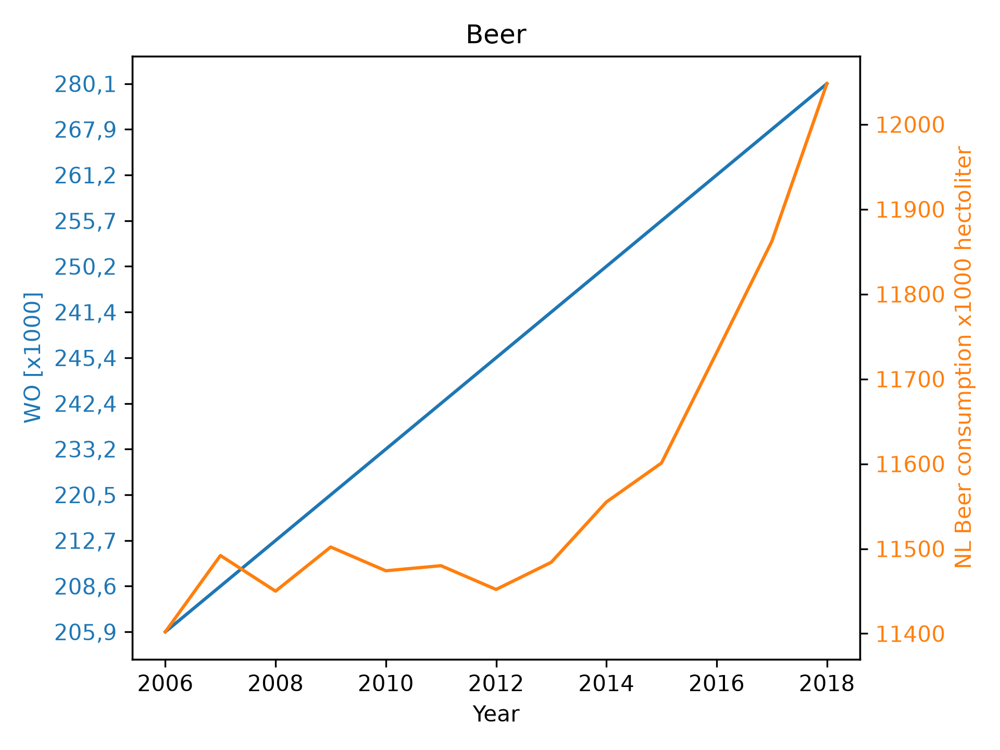

15210790

MCC Van Dyke et al., 2019

JT Harvey, Applied Ergonomics, 2002

DW Ziegler et al., 2005

We see that they are slightly correlated. They both increase over time, but the speed of growth seems to differ a lot...
